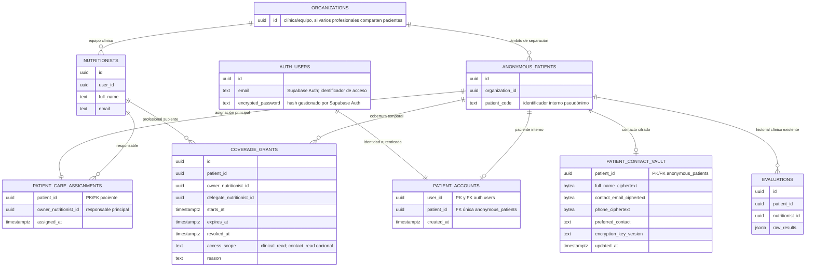

# Propuesta: identidad y datos de contacto de pacientes

## Alcance de esta propuesta

Diseñar los puntos 1 y 2: asociar una cuenta de Supabase Auth con un paciente clínico y guardar los datos mínimos de contacto de forma protegida. Este documento no modifica la base de datos ni presupone que una migración local esté aplicada en Supabase remoto.

## Hallazgo del flujo actual

El formulario contiene nombre, apellido, correo, teléfono, país y fecha de nacimiento en `personalInformation`; el campo de documento de identidad se retiró porque no es necesario para el seguimiento inicial. `saveEvaluation` envía el `formData` a `/api/public-evaluations`, y esa ruta reenvía el payload al RPC `submit_public_evaluation`. La función local `buildAnonymizedRawResults` omite varios campos identificativos, pero el payload también incluye el `formData` original. Sin inspeccionar la función que está desplegada en Supabase no se puede afirmar qué campos se persisten allí.

Antes de guardar información clínica hay que verificar el comportamiento de la función remota y separar los campos de identidad del payload clínico. La identidad y los datos de contacto deben enviarse por un flujo separado, autenticado y validado en servidor.

El flujo local ahora requiere que el paciente tenga sesión antes de abrir `/` y que el endpoint de guardado valide esa sesión y llame al RPC con el JWT del paciente. El enlace de invitación se conserva durante registro/inicio de sesión. La zona profesional y la generación de invitaciones también comprueban que el usuario sea nutricionista. Esto corrige el envío previo de una petición anónima, pero no demuestra por sí solo que la función RPC remota asigne correctamente la evaluación a la identidad del paciente; falta validarlo con una cuenta y una invitación de prueba.

## Modelo recomendado

`patient_accounts` es la asociación entre `auth.users.id` y el `anonymous_patients.id` que ya usa el historial. El `patient_code` sigue siendo un identificador interno; no debe usarse como contraseña ni como único control de acceso.

### Cómo identificar al paciente para seguimiento

Usar un UUID interno aleatorio como clave estable y, si la nutricionista necesita un código para reconocer el expediente en conversación, un código legible aleatorio por organización (por ejemplo `NJF-7K4P-92MD`). El código no debe contener iniciales, fecha de nacimiento, país, documento ni datos inferibles. La autorización se basa en sesión y RLS, nunca en conocer el UUID/código.

Cada clínica/equipo debería ser un ámbito separado (`organization_id`). Los profesionales acceden solo a pacientes de su organización asignados según reglas explícitas. No crear un ID global que permita a diferentes clínicas correlacionar el mismo paciente. El enlace de seguimiento funciona desde `auth.users.id` → `patient_accounts.patient_id` → evaluaciones, y el backend autorizado consulta el registro cifrado de contacto.

### Privacidad entre nutricionistas y cobertura

El acceso normal será privado por paciente: una asignación principal única (`patient_care_assignments`) vincula cada paciente a su nutricionista responsable. Los demás profesionales no obtienen acceso por compartir el sistema o la organización.

Para vacaciones o suplencias, el responsable podrá conceder una cobertura individual con profesional suplente, motivo, inicio y vencimiento. El permiso podrá revocarse antes de la fecha final. Por defecto, la cobertura permite revisar el historial (`clinical_read`); ver los datos de contacto requiere un permiso explícito separado (`contact_read`). La edición clínica queda deshabilitada salvo autorización expresa. Cada lectura o descifrado de contacto debe quedar auditado. Al vencer o revocar la cobertura, el acceso cesa. La reasignación permanente se gestiona como un cambio de responsable, no como una cobertura abierta.

Las reglas se aplican en la base (RLS y privilegios), no solo ocultando botones. Las políticas para evaluaciones y contacto permiten al responsable principal o a un suplente con cobertura vigente y no revocada. Solo el responsable puede conceder cobertura; un suplente no puede delegar a un tercero. Los IDs de nutricionista se derivan de `auth.uid()` en el servidor/base, nunca se confían desde el navegador.

## Credenciales e identificadores

- **Contraseña:** nunca se guarda en las tablas de la aplicación. Supabase Auth verifica y guarda su hash bcrypt con salt. No implementar hashing propio.
- **Usuario:** evitar un nombre de usuario adicional. Usar el correo verificado para iniciar sesión simplifica recuperación y seguimiento.
- **UUID de Auth:** usar `auth.users.id` como clave de vínculo. No es secreto ni contraseña; debe protegerse con autorización y RLS.
- **Documento/ID nacional:** recomendación inicial: no pedirlo ni almacenarlo hasta identificar una necesidad clínica, administrativa o legal concreta. No es adecuado guardar un hash simple de un documento de baja entropía: se puede adivinar y comparar. Si resulta obligatorio, minimizarlo, cifrarlo con cifrado autenticado y restringir su lectura.
- **Correo de login:** Supabase Auth necesita conservar el correo asociado a la cuenta. Por eso no es realista prometer que ningún dato identificativo exista en la base de datos mientras el acceso sea email+contraseña. La propuesta evita duplicar ese correo por defecto; el correo de contacto alternativo se cifra.

## Protección del contacto

Guardar nombre, correo alternativo y teléfono internacional con **cifrado de aplicación AES-256-GCM** antes de escribirlos en Postgres. Guardar nonce, ciphertext, tag y versión de clave; no guardar la clave junto a la tabla ni en variables `NEXT_PUBLIC_*`. La clave debe vivir en un gestor de secretos/KMS disponible solo en el backend. La app descifra solo cuando una persona autorizada necesita contactar al paciente. El cifrado en disco de la plataforma y TLS son capas adicionales, no sustitutos del cifrado de aplicación si se quiere impedir que una lectura de la tabla revele los valores.

No usar hash para teléfono/correo si la app necesita recuperarlos. Un HMAC puede servir para búsquedas exactas en casos concretos, pero filtra igualdad entre valores y añade gestión de claves; no hace falta si la aplicación no necesita buscar por contacto.

La preferencia puede ser `email`, `phone` o `whatsapp`. No habilitar WhatsApp hasta definir el canal, el proveedor y el aviso correspondiente. No guardar notas de contacto que no sean necesarias.

## Flujo propuesto

1. El paciente crea una cuenta con correo y contraseña en Supabase Auth; Auth envía la verificación de correo.
2. Tras verificar e iniciar sesión, completa nombre y canal(es) de contacto estrictamente necesarios.
3. Un endpoint de servidor valida la sesión con `auth.getUser()`, valida los campos y cifra el contacto antes de escribirlo.
4. Una operación transaccional crea un `anonymous_patients` nuevo y el vínculo único `auth.users.id` ↔ `anonymous_patients.id`; nunca se acepta un `patient_id` elegido por el navegador.
5. Al guardar una evaluación autenticada, el servidor toma el `patient_id` del vínculo de base de datos y comprueba la asignación activa; no confía en IDs de paciente o nutricionista enviados por el cliente.
6. El seguimiento obtiene contacto descifrado solo para el responsable o una suplencia vigente y registra la operación sin incluir PII en logs.

No vincular cuentas nuevas con expedientes históricos basándose únicamente en nombre, correo o documento suministrado en un formulario. Esa migración requiere un procedimiento de verificación de identidad y revisión de duplicados.

## Privacidad: recomendaciones para preparar cumplimiento

Estas medidas ayudan a diseñar con privacidad, pero no constituyen certificación de cumplimiento. La ley aplicable depende de dónde se encuentre quien controla el tratamiento, dónde están los pacientes y cómo se ofrece el servicio.

- Documentar propósito y base legal por finalidad antes de desplegar: evaluación/atención y seguimiento clínico no son lo mismo que marketing. No asumir que un único consentimiento resuelve las bases legales. Para datos de salud, revisar tanto la base general como la excepción aplicable a categorías sensibles (GDPR arts. 6 y 9; LGPD arts. 7 y 11).
- Mostrar un aviso de privacidad antes de recopilar información: responsable/controlador, datos y finalidades, destinatarios/proveedores, transferencias internacionales, plazo de conservación, derechos y canal de contacto.
- Recoger solo los datos necesarios. Definir un plazo de conservación para datos de contacto y uno para historia clínica conforme a obligaciones profesionales y legales; no borrar automáticamente historia clínica sin revisar esas obligaciones.
- Dar mecanismos para acceso, corrección, exportación y solicitudes de eliminación/restricción, con revisión de excepciones de conservación clínica.
- Revisar residencia/región de Supabase, contrato de tratamiento (DPA), subencargados, copias de seguridad y transferencias internacionales.
- No asumir que la LGPD exige por defecto que todo dato de una persona en Brasil permanezca físicamente en Brasil. La transferencia internacional tiene condiciones y mecanismos regulados por la LGPD y la Resolução ANPD 19/2024; hay que mapear el flujo concreto (incluidos hosting, soporte, copias y accesos) y validarlo jurídicamente antes de escoger región.
- Aplicar RLS y privilegios mínimos en cada tabla; permitir al paciente solo su perfil y su historial; limitar al profesional a sus pacientes vinculados. Probar explícitamente casos permitidos y denegados.
- MFA para cuentas profesionales, protección contra abuso de registro/login, revisión de secretos, backups probados, procedimiento de incidentes y logs sin nombre, correo, documento, teléfono, contraseña ni tokens.
- Evaluar si corresponde una evaluación de impacto/relatório de impacto por el tratamiento de datos de salud y el riesgo concreto.

## Decisiones previas a la migración

1. Confirmar países donde opera la nutricionista y dónde están los pacientes, y quién será responsable/controlador.
2. Confirmar si `identificationNumber` es realmente necesario; opción recomendada por defecto: no recopilarlo.
3. Elegir correo como usuario de acceso y confirmar si el correo de contacto será siempre el mismo o podrá ser distinto.
4. Elegir cifrado de aplicación y servicio de gestión de claves disponible para el despliegue.
5. Revisar la función RPC desplegada y la base remota con un inventario de solo lectura antes de escribir una migración compatible.
6. Confirmar el alcance propuesto para suplencias: lectura clínica por defecto, contacto explícito y edición deshabilitada salvo autorización.

## Fuentes oficiales consultadas

- [GDPR, texto oficial EUR-Lex](https://eur-lex.europa.eu/legal-content/EN/TXT/?uri=CELEX:32016R0679): principios de finalidad, minimización y conservación (art. 5), bases legales (art. 6), datos de salud (art. 9) y medidas de seguridad, incluidas pseudonimización/cifrado (art. 32).
- [ANPD, guía orientativa LGPD](https://www.gov.br/anpd/pt-br/assuntos/noticias/guia_lgpd_final.pdf): necesidad, pseudonimización y medidas para reducir identificación.
- [LGPD, legislación oficial brasileña](https://www.planalto.gov.br/ccivil_03/_ato2015-2018/2018/lei/l13709.htm): categorías sensibles, bases legales y seguridad.
- [Supabase: seguridad de contraseñas](https://supabase.com/docs/guides/auth/password-security): Supabase Auth guarda contraseñas con bcrypt y salt.
- [Supabase: Row Level Security](https://supabase.com/docs/guides/database/postgres/row-level-security): combinar RLS, grants y `auth.uid()` y probar accesos permitidos y denegados.
